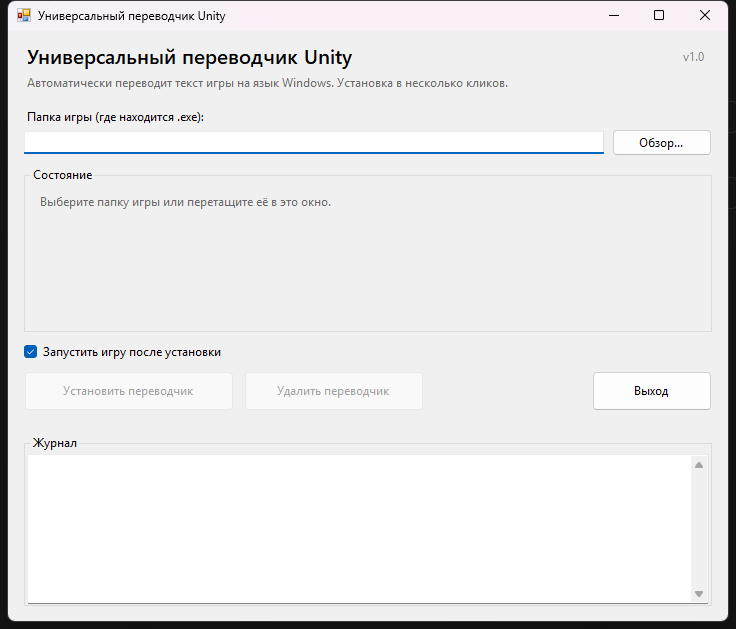

<p align="center">
  
</p>

<h1 align="center">Universal Unity Translator</h1>

<p align="center">
  Автоматический перевод текста Unity-игр на язык Windows — прямо в игре, без оверлеев и ручной правки файлов.
</p>

<p align="center">
  <a href="https://github.com/switbit/unity-translator/releases/latest"></a>
  
  
  <a href="LICENSE"></a>
</p>

---

## Скачать

Готовый установщик и архив с плагином лежат в разделе **[Releases](https://github.com/switbit/unity-translator/releases/latest)**:

- **`UnityTranslator-Setup.exe`** — установка в пару кликов.
- **`UnityTranslator-1.0.0.zip`** — установщик, README и DLL для ручной установки.
- **`SHA256SUMS.txt`** — контрольные суммы файлов.

> Установщик не подписан сертификатом. При первом запуске Windows SmartScreen может показать предупреждение — нажмите **«Подробнее» → «Выполнить в любом случае»**.

## Что это

Плагин для **BepInEx 5** и **Harmony**, который перехватывает текст стандартных Unity-компонентов, переводит его через Google Translate или LibreTranslate и заменяет строку прямо в интерфейсе игры.

Перевод включается автоматически: плагин определяет язык исходного текста и целевой язык Windows. Кэш переводов сохраняется локально, поэтому повторные запуски и уже встречавшиеся строки переводятся мгновенно.

<p align="center">
  
</p>

## Возможности

- **TextMeshPro (TMP)** — основной путь для современных Unity-игр.
- **uGUI Text** (`UnityEngine.UI.Text`) и **TextMesh** в 3D-сцене.
- Автоматическое определение исходного языка и языка Windows.
- **Замена текста в игре**, а не внешний оверлей.
- Безопасная работа с «печатающимся» текстом и послайдовыми катсценами:
  - плагин ждёт завершения посимвольного раскрытия TMP;
  - выдерживает дополнительную паузу после последнего видимого символа;
  - защищает корутины игр от замены текста в середине анимации;
  - не переписывает `StringBuilder`, который игра использует для своей логики.
- Горячая клавиша **F5** — восстановить исходный текст и заново применить перевод.
- Кэш переводов и шрифтовой fallback для языков с нелатинской письменностью.
- Гибкая настройка: задержки, минимальная длина строки, исключения по именам сцен и объектов.
- Поддержка **Google Translate** (по умолчанию) и **LibreTranslate** (свой сервер).
- Установщик сам определяет архитектуру игры, версию Unity и тип скриптов; при необходимости ставит BepInEx 5.4.23.6.

## Совместимость

| Требование | Поддержка |
|---|---|
| Unity | Mono, x86/x64 |
| Скриптовый бэкенд | Mono. **IL2CPP не поддерживается** |
| Текст | TextMeshPro, uGUI Text, TextMesh |
| Загрузчик | BepInEx 5.4.23.6 (ставится автоматически) |
| ОС | Windows 10/11 |
| Интернет | Нужен для Google Translate или своего LibreTranslate |

### Что не переводится

- Игры на **IL2CPP** — установщик откажется устанавливать плагин. Нужна отдельная версия под BepInEx 6 IL2CPP.
- **UI Toolkit (UIElements), NGUI, FairyGUI, IMGUI** и собственные системы вывода текста.
- Текст, «запечённый» в текстуры, изображения, видео или 3D-модели без компонента `TextMesh`.
- Строки, которые игра шифрует или собирает нестандартным способом.
- Игры с античитом, блокирующим внедрение DLL.

## Установка

1. Скачайте `UnityTranslator-Setup.exe` из [Releases](https://github.com/switbit/unity-translator/releases/latest).
2. Укажите папку игры (там, где лежит `.exe`), или перетащите её в окно установщика.
3. Нажмите **«Установить переводчик»**.
4. Запустите игру — перевод включится автоматически.

Если BepInEx ещё не установлен, установщик распакует подходящую версию. Если BepInEx уже есть, файлы ядра не перезаписываются — добавляется только плагин.

### Ручная установка

1. Установите [BepInEx 5.4.23.6](https://github.com/BepInEx/BepInEx/releases/tag/v5.4.23.6) для нужной архитектуры (x64 или x86).
2. Распакуйте архив в папку игры.
3. Скопируйте `UnityTranslator.Plugin.dll` в `BepInEx\plugins\UnityTranslator\`.
4. Запустите игру.

## Настройки

После первого запуска создаётся файл:

```
BepInEx\config\ru.unitytranslator.cfg
```

Основные параметры:

| Параметр | По умолчанию | Описание |
|---|---|---|
| `[General] Enabled` | `true` | Включить перевод. |
| `[General] TargetLanguage` | `auto` | Целевой язык. `auto` — язык Windows. Можно указать `ru`, `en`, `de`, `ja`, `zh-CN` и т.д. |
| `[General] ScanIntervalSeconds` | `3` | Как часто искать новые тексты в сцене (1–60 сек). |
| `[Text] StableTextDelayMs` | `400` | Пауза после последнего изменения текста перед переводом (0–5000 мс). Защищает от перевода «недопечатанных» строк. |
| `[Text] RevealGraceMs` | `1500` | Дополнительная пауза после завершения анимации раскрытия текста (0–10000 мс). Увеличьте, если игра всё ещё застревает на анимированном тексте. |
| `[Text] ReloadTextKey` | `F5` | Горячая клавиша перезагрузки текста. Имя из `UnityEngine.KeyCode` (`F5`, `F8`, `R`, `Home` и т.д.) или `None`, чтобы отключить. |
| `[Text] MinLetters` | `2` | Не переводить строки, в которых меньше этого числа букв. |
| `[Text] ExcludedNames` | пусто | Имена сцен, GameObject или компонентов через запятую, точку с запятой или `\|`, чей текст не переводится. Например: `Slides,Typewriter,EndingScreen`. |
| `[Translation] Provider` | `google` | `google` или `libretranslate`. |
| `[Translation] LibreTranslateUrl` | пусто | Адрес своего LibreTranslate, например `https://translate.example.com`. |
| `[Translation] LibreTranslateApiKey` | пусто | API-ключ LibreTranslate, если нужен. |
| `[Translation] RequestDelayMs` | `120` | Минимальная пауза между запросами (мс). |
| `[Translation] WorkerThreads` | `2` | Число фоновых потоков перевода (1–8). |
| `[Fonts] EnableFontFallback` | `true` | Подбирать системный шрифт для недостающих символов. |
| `[Diagnostics] LogTranslations` | `false` | Писать исходный и переведённый текст в лог. |
| `[Diagnostics] MaxTextLength` | `10000` | Не переводить строки длиннее этого размера. |

После изменения настроек перезапустите игру.

### Кэш

Переводы сохраняются в:

```
BepInEx\config\UnityTranslator\cache_<язык>.tsv
```

Это обычный TSV-файл с Base64-строками. Его можно удалить, чтобы игра заново получила переводы (например, после смены поставщика).

## Горячая клавиша F5

Если игра показала строку некорректно, «застряла» на слайде или вы хотите применить обновлённый кэш:

1. Нажмите **F5**.
2. Плагин вернёт исходный текст всем элементам, которые сейчас показывают перевод.
3. Через мгновение перевод применится заново.

Клавишу можно изменить через `[Text] ReloadTextKey`. Поддерживаются имена `UnityEngine.KeyCode`, например `F8`, `R`, `Home`. Значение `None` отключает горячую клавишу.

## Решение проблем

### Перевод не появляется

1. Откройте `BepInEx\LogOutput.log`.
2. Убедитесь, что есть строки `Patched N text method(s)` и `Ready`.
3. Включите `LogTranslations = true` в конфиге и перезапустите игру — в логе будут видны переведённые строки.
4. Проверьте, что игра на Mono, а не на IL2CPP.
5. Если текст нарисован на текстуре, плагин его не увидит — это ограничение метода.

### Текст в катсцене переводится с задержкой

Это нормально: плагин ждёт, пока закончится посимвольное раскрытие текста (TMP), и только потом заменяет строку. Так игры с послайдовыми катсценами не застревают и не теряют текст. Если конкретная сцена всё равно конфликтует с переводом, добавьте её имя в `[Text] ExcludedNames`.

### Текст отображается некорректно или «застрял»

Нажмите **F5** — плагин вернёт исходные строки и заново применит перевод к видимым элементам. Если это не помогло:

1. Увеличьте `[Text] RevealGraceMs` до `2500–3000` и перезапустите игру.
2. Для конкретной проблемной сцены добавьте её имя в `[Text] ExcludedNames`.
3. Включите `LogTranslations = true` и проверьте `BepInEx\LogOutput.log`.

### Квадраты или «тофу» вместо символов

- Убедитесь, что `EnableFontFallback = true`.
- Установите в Windows языковой пакет и шрифты для целевого языка.
- Для японского обычно нужен `Yu Gothic UI`, для китайского — `Microsoft YaHei UI`/`Microsoft JhengHei UI`, для корейского — `Malgun Gothic`.

### Ошибки 429 / переводы не идут

- Подождите несколько минут.
- Увеличьте `RequestDelayMs` до `300–500`.
- Уменьшите `WorkerThreads` до `1`.
- Настройте LibreTranslate и переключите `Provider = libretranslate`.

### Игра не запускается

- Проверьте `BepInEx\LogOutput.log`.
- Если в папке игры уже был другой `winhttp.dll`/`version.dll`, возможен конфликт загрузчиков. Удалите старый загрузчик или установите BepInEx вручную.
- Антивирус может блокировать `winhttp.dll` BepInEx — добавьте папку игры в исключения.
- Для отката удалите папку `BepInEx`, `winhttp.dll`, `doorstop_config.ini` и `.doorstop_version` (или воспользуйтесь кнопкой удаления переводчика, она оставляет BepInEx).

## Удаление

В установщике выберите игру и нажмите **«Удалить переводчик»**. Будут удалены:

- `BepInEx\plugins\UnityTranslator\`
- `BepInEx\config\UnityTranslator\` (кэш)
- `BepInEx\config\ru.unitytranslator.cfg`

BepInEx и другие моды останутся. Если BepInEx больше не нужен, удалите его вручную.

## Сборка из исходников

Нужны:

- .NET SDK 8 или новее;
- .NET Framework 4.x (`csc.exe`) для установщика;
- папка `Managed` любой Unity-игры на Mono — из неё берутся reference-сборки UnityEngine;
- ядро BepInEx 5.

Скачайте BepInEx и подготовьте кэш:

```powershell
powershell -ExecutionPolicy Bypass -File tools\fetch-bepinex.ps1
```

Соберите плагин и установщик:

```powershell
$env:UNITY_MANAGED_DIR = "C:\Games\MyGame\MyGame_Data\Managed"
powershell -ExecutionPolicy Bypass -File tools\build-release.ps1
```

`UNITY_BEPINEX_CORE` можно не задавать: скрипт возьмёт `.cache\BepInEx\BepInEx\core`. Результат появится в `dist\`.

Иконка установщика (многоразмерный `.ico`) генерируется скриптом:

```powershell
powershell -ExecutionPolicy Bypass -File tools\make-icon.ps1
```

## Конфиденциальность

Переводимый текст отправляется на выбранный сервис перевода (по умолчанию — Google Translate). Плагин не собирает телеметрию и не отправляет ничего, кроме текста, который нужно перевести. Кэш хранится локально. Для полностью локального перевода используйте собственный LibreTranslate.

## Лицензия

Проект распространяется по лицензии **MIT**. См. [LICENSE](LICENSE).

BepInEx, HarmonyX и другие сторонние компоненты имеют собственные лицензии — см. [THIRD_PARTY_NOTICES.md](THIRD_PARTY_NOTICES.md).

## Благодарности

- [BepInEx](https://github.com/BepInEx/BepInEx) — загрузчик плагинов.
- [HarmonyX](https://github.com/BepInEx/HarmonyX) — патчинг методов.
- Google Translate и LibreTranslate — перевод.
